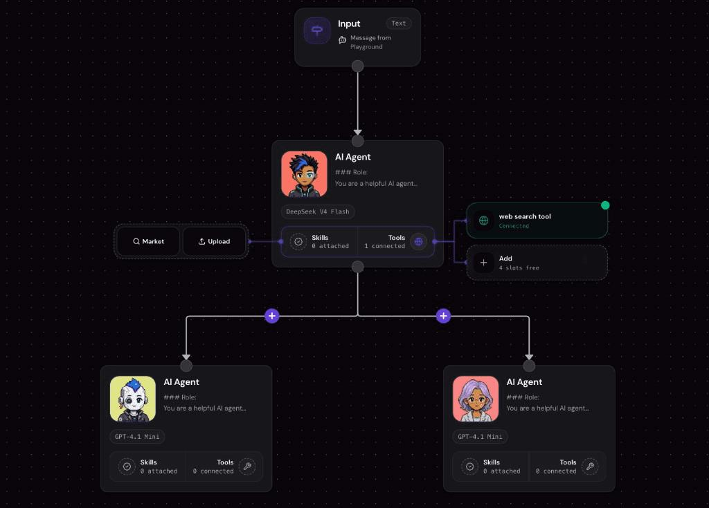
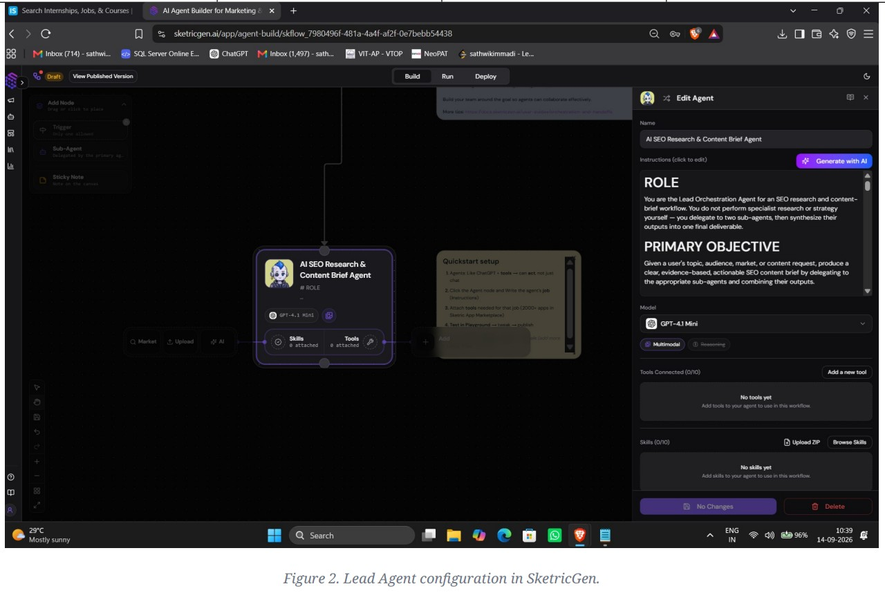
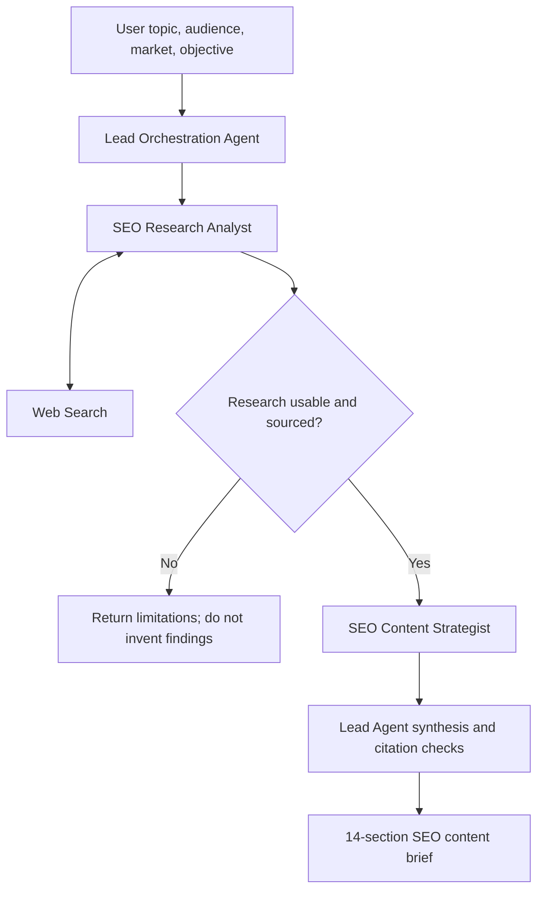

# AI SEO Research & Content Brief Agent

A multi-agent AI workflow built in **SketricGen** to turn a topic, audience, target market, and content objective into an evidence-aware SEO content brief.

> **Project format:** This repository documents a visual workflow configured on SketricGen. It is a portfolio and design document, not a source-code implementation. The workflow's executable configuration remains on the platform; this repository does not contain a standalone Python package or deployable agent runtime.

## Workflow at a glance

The Lead Orchestration Agent coordinates two specialized agents: an SEO Research Analyst that uses web search, and an SEO Content Strategist that turns the research handoff into a content plan. The lead agent then reviews and synthesizes the results into a structured 14-section brief.



*Figure 1. Workflow canvas from the SketricGen project.*

## Agent configuration

The assessed configuration used GPT-4.1 Mini for all three agents. The SEO Research Analyst had the Web Search tool configured; the Lead Orchestration Agent and SEO Content Strategist had no separate tools configured in the assessment.



*Figure 2. Lead agent configuration in SketricGen. The image illustrates the configured instructions and selected model.*

## What it does

Given a content request, the workflow:

1. Extracts the topic, audience, market, objective, and requested format.
2. Delegates current-information gathering to an SEO Research Analyst agent equipped with web search.
3. Checks that research findings are substantive and sufficiently sourced before proceeding.
4. Passes the research to an SEO Content Strategist agent to develop search intent, keyword/topic-phrase ideas, content angle, structure, and differentiation opportunities.
5. Synthesizes the research and strategy into a structured 14-section content brief, preserving source references and marking inferences or recommendations where appropriate.

## Agent roles and tools

| Component | Model in the assessed configuration | Responsibility | Tools |
|---|---|---|---|
| Lead Orchestration Agent | GPT-4.1 Mini | Understands the request, manages sequencing, validates the handoff, and synthesizes the final brief | No separate tool configured |
| SEO Research Analyst | GPT-4.1 Mini | Collects current findings, source references, audience questions, and observed content gaps | Web Search |
| SEO Content Strategist | GPT-4.1 Mini | Converts supplied research into an SEO strategy and content plan | No separate tool configured |

The model configuration above reflects the project assessment document and may change if the platform configuration is updated.

## Workflow sequence



The research and strategy stages are deliberately separated: the strategist should use the current research output supplied in the handoff rather than independently inventing evidence or proceeding from the original request alone.

## Prompt design

The repository includes the system instructions documented for all three agents:

- [Lead Orchestration Agent](prompts/lead-orchestrator.md) — controls execution order, validates the research handoff, synthesizes the final brief, and checks source alignment.
- [SEO Research Analyst](prompts/seo-research-analyst.md) — gathers current information through web search and separates sourced findings from interpretation.
- [SEO Content Strategist](prompts/seo-content-strategist.md) — uses the research handoff to develop the SEO strategy without inventing evidence.

See [Prompts README](prompts/README.md) for details. These files document the instructions configured in SketricGen; they are not executable agent code. Confirm you are permitted to share the prompt text before making the repository public.

## Example test scenario

The documented end-to-end test used this request:

- **Topic:** How AI agents are transforming customer support for SaaS companies
- **Audience:** SaaS founders and customer-support leaders
- **Market:** United States
- **Objective:** An educational article with practical opportunities to improve customer support using AI agents
- **Deliverable:** A detailed but concise SEO content brief for a writer

The assessment report describes a successful run that produced the required 14-section brief. A sample excerpt is available in [`examples/sample-brief-excerpt.md`](examples/sample-brief-excerpt.md).

## Evaluation and limitations

The project assessment checked the output structure, source preservation, handling of inferred versus recommended content, keyword framing, and assumption handling. It also documented improvement opportunities, including adding an independent keyword-data source and increasing the diversity of evidence for important market claims.

These are qualitative checks from a documented example, not a published benchmark. No quantified success rate, latency benchmark, automated regression suite, or production telemetry is claimed in this repository. Further details are in [Evaluation and limitations](docs/evaluation-and-limitations.md).

## Limitations and next steps

- The workflow depends on the capabilities and configuration of SketricGen and the connected web-search tool.
- A suggested topic phrase is not equivalent to measured keyword demand; keyword volume and difficulty require a dedicated data source.
- Source attribution supports traceability, but it does not guarantee that every source is authoritative or every generated claim is correct. Sources still need review.
- The project was validated with a documented example. The assessment does not establish customer adoption, production-scale operation, or long-running persistent memory/checkpointing.
- Potential next steps include testing more topics and markets, defining a repeatable evaluation set, checking citations automatically, tracking tool failures, and measuring output quality across runs.

## Repository structure

```text
ai-seo-research-content-agent/
├── assets/
│   ├── agent_workflow.jpg
│   └── agent_configuration.jpg
├── docs/
│   ├── evaluation-and-limitations.md
│   └── workflow-and-agent-roles.md
├── examples/
│   └── sample-brief-excerpt.md
├── prompts/
│   ├── lead-orchestrator.md
│   ├── seo-research-analyst.md
│   ├── seo-content-strategist.md
│   └── README.md
└── README.md
```

## Author

**Immadi Sathwik** — Computer Science undergraduate specializing in Artificial Intelligence and Machine Learning.
