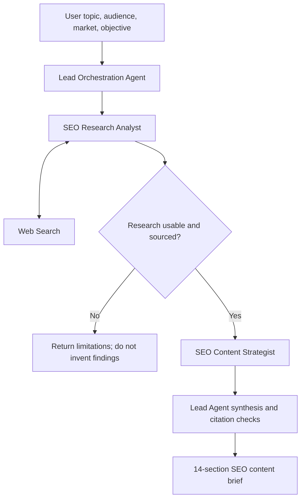

# AI SEO Research & Content Brief Agent

A multi-agent AI workflow built in **SketricGen** to turn a topic, audience, target market, and content objective into an evidence-aware SEO content brief.

> **Project format:** This repository documents a visual workflow configured on SketricGen. It is a portfolio and design document, not a source-code implementation. The workflow's executable configuration remains on the platform; this repository does not contain a standalone Python package or deployable agent runtime.

## What it does

Given a content request, the workflow:

1. Extracts the topic, audience, market, objective, and requested format.
2. Delegates current-information gathering to an SEO Research Analyst agent equipped with web search.
3. Checks that research findings are substantive and sufficiently sourced before proceeding.
4. Passes the research to an SEO Content Strategist agent to develop search intent, keyword/topic-phrase ideas, content angle, structure, and differentiation opportunities.
5. Synthesizes the research and strategy into a structured 14-section content brief, preserving source references and marking inferences or recommendations where appropriate.

## Agent roles and tools

| Component | Model in the assessed configuration | Responsibility | Tools |
|---|---|---|---|
| Lead Orchestration Agent | GPT-4.1 Mini | Understands the request, manages sequencing, validates the handoff, and synthesizes the final brief | No separate tool configured |
| SEO Research Analyst | GPT-4.1 Mini | Collects current findings, source references, audience questions, and observed content gaps | Web Search |
| SEO Content Strategist | GPT-4.1 Mini | Converts supplied research into an SEO strategy and content plan | No separate tool configured |

The model configuration above reflects the project assessment document and may change if the platform configuration is updated.

## Workflow

The research and strategy stages are deliberately separated: the strategist should use the current research output supplied in the handoff rather than independently inventing evidence or proceeding from the original request alone.

For more detail, see [Workflow and agent responsibilities](docs/workflow-and-agent-roles.md) and [Evaluation and limitations](docs/evaluation-and-limitations.md).

## Example test scenario

The documented end-to-end test used this request:

- **Topic:** How AI agents are transforming customer support for SaaS companies
- **Audience:** SaaS founders and customer-support leaders
- **Market:** United States
- **Objective:** An educational article with practical opportunities to improve customer support using AI agents
- **Deliverable:** A detailed but concise SEO content brief for a writer

The assessment report describes a successful run that produced the required 14-section brief. A short excerpt is included in [`examples/sample-brief-excerpt.md`](examples/sample-brief-excerpt.md).

## Evaluation approach

The project assessment checked the output structure, source preservation, handling of inferred versus recommended content, keyword framing, and assumption handling. It also documented improvement opportunities, including adding an independent keyword-data source and increasing the diversity of evidence for important market claims.

These are qualitative checks from the project run, not a published benchmark. No quantified success rate, latency benchmark, or production telemetry is claimed in this repository.

## Limitations and next steps

- The workflow depends on the capabilities and configuration of SketricGen and the connected web-search tool.
- A suggested topic phrase is not equivalent to measured keyword demand; keyword volume and difficulty require a dedicated data source.
- Source attribution supports traceability, but it does not guarantee that every source is authoritative or that every generated claim is correct. Sources still need review.
- The project was validated with a documented example. The assessment does not establish customer adoption, production-scale operation, or long-running persistent memory/checkpointing.
- Potential next steps include testing more topics and markets, defining a repeatable evaluation set, checking citations automatically, tracking tool failures, and measuring output quality across runs.

## Repository scope

This repository shares documentation of the workflow design and one sample output excerpt. It does not include the complete assessment PDF, full platform screenshots, export files, credentials, or a code-based implementation. Add any additional materials only if you have permission to publish them and have checked them for private or assessment-specific information.

## Author

**Immadi Sathwik** — Computer Science undergraduate specializing in Artificial Intelligence and Machine Learning.
